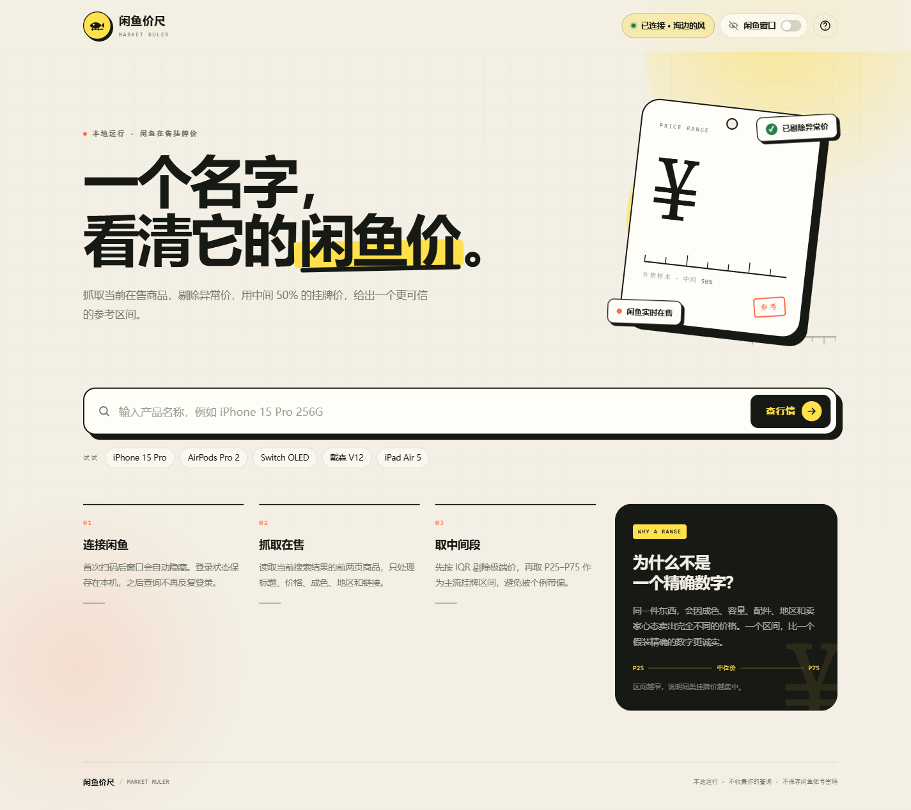
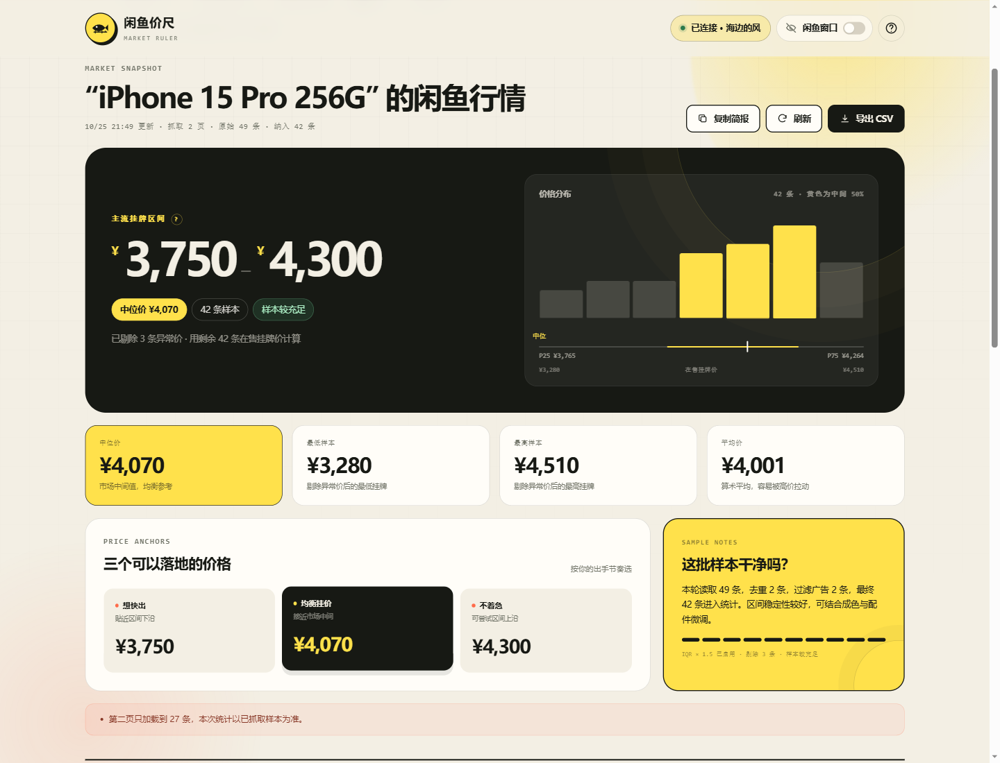
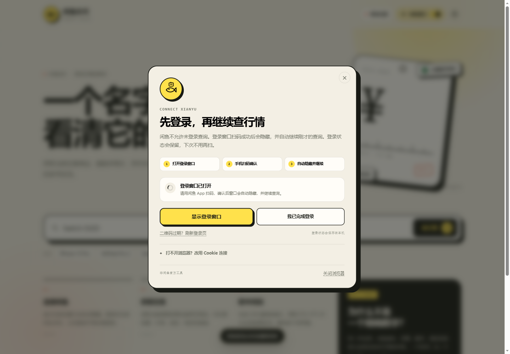

# 闲鱼价尺 · Xianyu Price Ruler

输入一个产品名称，抓取闲鱼当前在售商品，自动剔除异常价，给出一个比单条商品更有参考意义的价格区间。

> 非闲鱼官方工具。价格为**在售挂牌价**，不是成交价；仅供个人比价参考。





> 截图使用示例数据，实际结果来自闲鱼实时在售列表。

## 它能做什么

- **输入即查**：输入 `iPhone 15 Pro 256G`、`AirPods Pro 2`、`Switch OLED` 等产品名，直接得到行情。
- **主流挂牌区间**：剔除异常价后，取 P25–P75 作为中间 50% 的价格带。
- **中位价与定价锚点**：给出想快出、均衡挂价、不着急三个参考价位。
- **价格分布图**：直观看同类商品集中在哪一段。
- **样本证据**：列出在售商品、价格、成色标签、地区、想要人数和原链接，可按价格/想要人数/发布时间排序。
- **导出与分享**：一键复制行情简报，或导出 CSV 做自己的表。
- **单页面操作**：应用本身只有一个页面；闲鱼窗口默认隐藏，不会跳出来干扰查询。
- **窗口开关**：页面顶部有「闲鱼窗口」开关，需要扫码、处理验证或查看原页面时随时显示，再点一下隐藏。
- **登录保持**：登录成功后自动收起窗口；下次打开程序或再次查询会自动恢复登录，不需要每次扫码。
- **本地优先**：服务只监听 `127.0.0.1`，登录态只保存在本机浏览器配置目录，不上传账号或查询。

## 为什么需要登录闲鱼

闲鱼对未登录搜索会做访问限制，通常返回空结果、登录弹窗或风控页。这个工具使用**你本机登录的闲鱼网页会话**读取搜索结果：

1. 只有首次使用或登录过期时，才会出现登录窗口；
2. 用闲鱼 App 扫码，并在手机上确认登录；
3. 登录成功后窗口会自动隐藏，继续刚才的查询；
4. 登录状态保存在本机，之后启动应用会自动在后台恢复，不再反复扫码。

页面顶部的「闲鱼窗口」开关可以随时显示或隐藏这个浏览器窗口。隐藏时浏览器仍在后台运行，登录状态不会掉。

程序不会读取你日常浏览器的密码，也不会获取闲鱼账号密码。



## 快速开始

### 环境要求

- Windows 10 / 11（macOS、Linux 也支持，见手动启动）
- Node.js **20 或更高版本**
- Microsoft Edge 或 Google Chrome

### Windows 一键启动

双击：

```text
启动程序.cmd
```

脚本会自动找到 Node.js、检查依赖、启动服务，并用默认浏览器打开：

```text
http://127.0.0.1:7788
```

首次查询如果需要登录，会短暂出现扫码窗口；登录成功后自动隐藏，并继续查询。之后再打开或查询，会自动恢复登录。

### 手动启动

```bash
npm install
npm start
```

然后打开 <http://127.0.0.1:7788>。

如果 7788 被占用：

```powershell
# PowerShell
$env:PORT=7799; npm start
```

```bat
:: cmd
set PORT=7799 && npm start
```

## 第一次使用的完整流程

1. 在输入框里输入具体产品名，例如 `iPhone 15 Pro 256G`，点「查行情」。
2. 如果没有保存过登录，程序会自动显示登录窗口；如果之前登录过，会直接在后台恢复，不弹窗。
3. 首次使用时，用闲鱼 App 扫码，在手机上点「确认登录」。
4. 登录成功后窗口自动隐藏，页面状态变为「已连接」，刚才的查询自动继续。
5. 得到区间后，可以点「复制简报」或「导出 CSV」。

如果二维码过期，在登录弹窗里点「二维码过期？刷新登录页」。
如果出现滑块、安全验证或拍脸验证，用页面顶部的「闲鱼窗口」开关把窗口显示出来，手动完成后点「再试一次」。

## 窗口开关与登录保持

- **默认隐藏**：程序启动后只显示应用单页，闲鱼浏览器窗口会被放到屏幕外。
- **随时开关**：点击顶部「闲鱼窗口」开关即可显示或隐藏。显示时会带回正常窗口大小并置于前台。
- **隐藏不掉登录**：隐藏只是把窗口移出屏幕，浏览器仍在后台运行，查询和登录状态都保留。
- **重启自动恢复**：登录成功后会写入本机浏览器配置。下次启动时程序会静默启动隐藏浏览器并恢复登录，不需要再次扫码。
- **登录过期才需要重扫**：Cookie 失效时，查询会再次打开登录窗口。
- **关闭浏览器**：登录弹窗里的「关闭浏览器」会关闭后台浏览器；登录 Cookie 仍保留，下次查询会尝试恢复。
- Windows 任务栏可能仍显示一个浏览器图标，这是后台浏览器进程的正常表现；窗口本身不会出现在桌面上。

## 区间是怎么算的

程序读取搜索结果的**前两页**（通常最多 60 条），然后：

1. 去掉重复商品、广告和没有有效价格的条目；
2. 当有效样本不少于 12 条时，用 IQR（1.5 × 四分位距）剔除极端低/高价；
3. 对剩余价格排序，取：
   - **P25**：25% 分位，区间下沿；
   - **中位价**：50% 分位，均衡参考；
   - **P75**：75% 分位，区间上沿；
4. 根据价格量级做取整，避免展示虚假的精确度；
5. 样本数决定置信提示：
   - ≥ 40 条：样本较充足
   - 20–39 条：样本够用
   - 8–19 条：样本偏少
   - < 8 条：仅供参考

页面里的三个落地价位：

| 档位 | 取值 | 适合 |
| --- | --- | --- |
| 想快出 | P25（区间下沿） | 希望更快成交，接受少赚一点 |
| 均衡挂价 | 中位价 | 不急着出，也不想挂太久 |
| 不着急 | P75（区间上沿） | 愿意等合适的买家 |

**局限**：关键词太宽（例如只搜「iPhone」）会把不同型号、容量、成色的商品混在一起；热门电子产品也可能混入配件、仿品或「同款」。价格还会受是否包邮、地区和卖家心态影响。尽量把品牌、型号、容量、版本写进关键词，并结合下方样本列表判断，区间会更有意义。

## 常见问题

### 看不到闲鱼窗口

默认情况下窗口是隐藏的，这是正常状态。点页面顶部的「闲鱼窗口」开关即可显示；再点一次隐藏。隐藏不会退出登录。

如果连开关也无法打开窗口：

- 检查任务栏，窗口可能被其他窗口挡住。
- 确认电脑安装了 Microsoft Edge 或 Google Chrome。
- 手动运行 `npm start` 看控制台是否报错；也可以设置浏览器路径：

```powershell
$env:XIANYU_BROWSER_PATH="C:\Program Files (x86)\Microsoft\Edge\Application\msedge.exe"
npm start
```

### 扫码后一直显示「等待扫码」

- 确认手机上点了「确认登录」。
- 等 3–5 秒，程序会自动检测登录 Cookie。
- 用顶部「闲鱼窗口」开关确认登录页确实可见。
- 仍不行时点「我已完成登录」强制检查一次。
- 如果浏览器里被滑块或安全验证挡住，先用开关显示窗口并完成验证。

### 登录状态失效了

点击右上角「登录已失效」或「未连接闲鱼」，重新扫码即可。登录 Cookie 过期属于正常现象；正常情况下重启程序会自动恢复，不需要每次登录。

### 提示需要访问验证 / 被拦截

闲鱼触发了风控。请用顶部「闲鱼窗口」开关显示浏览器窗口，在窗口中完成验证，然后回到网页点「再试一次」。不要高频连续查询。

### 提示浏览器配置被占用 / 无法启动浏览器

通常是上一次的浏览器窗口没有正常关闭：

1. 关闭所有本程序打开的闲鱼浏览器窗口；
2. 重新启动程序；
3. 如果仍失败，在程序完全关闭后删除 `.data/browser-profile/SingletonLock` 再试。

不要删除整个 `.data/browser-profile`，否则需要重新扫码登录。

### Cookie 登录怎么用

在登录弹窗底部展开「打不开浏览器？改用 Cookie 连接」，从已登录闲鱼的浏览器里：

`F12` → 网络（Network）→ 任选一个闲鱼请求 → 请求头（Headers）→ 复制 `Cookie` 后面的完整内容。

需要从 DevTools 的请求头复制，因为关键 Cookie 是 HttpOnly 的，`document.cookie` 拿不到。

### 搜不到结果

- 换更具体的名称，例如把「iPhone」换成「iPhone 15 Pro 256G」；
- 检查浏览器窗口里闲鱼是否正常显示搜索结果；
- 稍后再试，避免触发访问验证。

## 隐私与安全

- Web 服务只绑定 `127.0.0.1`，局域网其他设备无法访问。
- 登录信息保存在本机 `.data/browser-profile`（浏览器配置文件），不会上传到任何服务器。
- 程序启动时会在后台用该配置自动恢复登录，因此不需要每次扫码。
- 不保存闲鱼密码；扫码登录的 Cookie 由浏览器管理。
- 查询历史只存在当前浏览器的 `localStorage` 里。
- `.data/` 里的内容等同于登录凭证，请不要打包分享给他人。

## 开发与测试

```bash
# 单元测试：价格解析、IQR、分位数、区间构造
npm test
```

项目结构：

```text
server.js             本地 HTTP 服务与 API
lib/xianyu.js         Playwright 浏览器会话、登录、搜索
lib/normalize.js      闲鱼返回数据清洗
lib/analysis.js       IQR、分位数、直方图、定价档位
lib/market.js         汇总成前端结果
public/               原生 HTML / CSS / JS 界面
tests/                单元测试；ui-check.js 用于本地视觉/交互检查
docs/                 界面截图
启动程序.cmd          Windows 一键启动
```

视觉检查脚本 `tests/ui-check.js` 使用 mock 数据，不会查询真实商品。为了不触发后台自动恢复，先以测试模式启动服务：

```powershell
# PowerShell
$env:NO_OPEN='1'; $env:NO_RESTORE='1'; npm start
```

另开终端运行：

```bash
node tests/ui-check.js
```

它会用 Edge 打开本地页面、截图到 `docs/`，并检查窗口开关、列表展开、复制和 CSV 导出。

## 免责声明

- 本项目与闲鱼 / 阿里巴巴无关联，未获得官方授权。
- 数据来自闲鱼公开搜索页的当前在售商品，可能受登录状态、地域、个性化推荐和时间影响。
- 价格区间是统计参考，不构成成交承诺或投资建议。
- 请遵守闲鱼社区规则和相关法律法规，不要用于高频抓取、商业转售或其他侵害平台和他人权益的用途。
